<p align="center">
  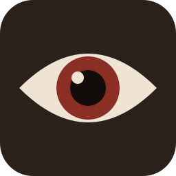
</p>

<h1 align="center">Die Schwarze Ahnentafel</h1>

<p align="center">
  Heldenerschaffung und Steigerung für <em>Das Schwarze Auge, 5. Edition</em><br>
  für Windows, Linux und Android
</p>

<p align="center">
  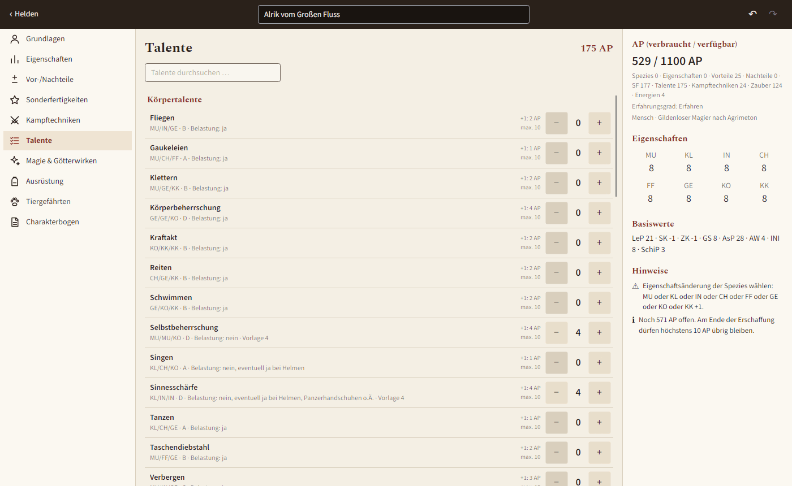
</p>

## Funktionen

- **Heldenerschaffung Schritt für Schritt:** Erfahrungsgrad, Spezies, Kultur und Profession, Eigenschaften,
  Vor- und Nachteile, Sonderfertigkeiten, Kampftechniken, Talente, Zauber und Liturgien, Ausrüstung.
- **Kultur und Profession sind Vorlagen.** Sie füllen den Helden vor, danach lässt sich alles abwandeln. Die
  Paketkosten berechnet die App aus dem Inhalt.
- **AP immer im Blick:** Die rechte Spalte zeigt verbrauchte und verfügbare AP, Eigenschaften, Basiswerte und
  Hinweise auf Regelverstöße. Die App warnt, sperrt aber nichts.
- **Steigerungsphase mit Protokoll:** Nach der Erschaffung landet jede Steigerung und jede AP-Gutschrift im
  Protokoll. Dort lässt sie sich auch wieder zurücknehmen.
- **Tiergefährten und Vertraute** nach dem Kodex des Schwertes, jedes Tier mit eigenen Werten und eigenem Protokoll.
- **Charakterbogen als PDF**, auch auf dem Handy, dazu ein eigenes PDF mit den Regeltexten der Zauber und Liturgien.
- **Quellen wählbar:** Welche Publikationen gelten, lässt sich je Held und als Standard ein- und ausschalten.
- **Import und Export** von Helden aus [Optolith](https://optolith.app/) und Dark Aid (`*.tdc`).
- **Zwei Stile:** „Heldendokument“ (hell) und „Nachtlager“ (dunkel).

## Bilder

| Grundlagen und Spezies | Kultur wählen |
|---|---|
| 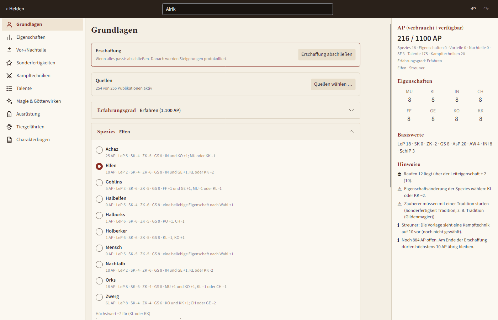 | 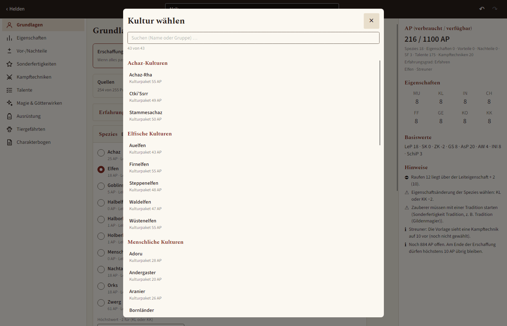 |
| **Steigerung mit Protokoll** | **Tiergefährte (Vertrauter)** |
| 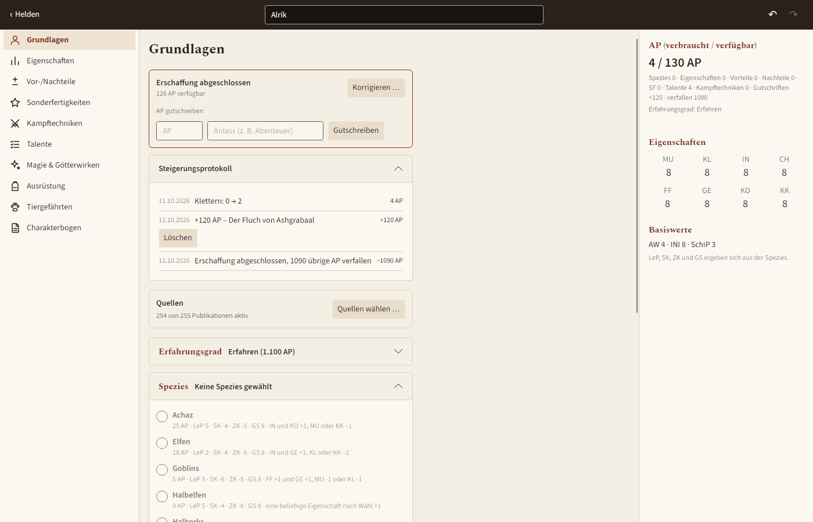 | 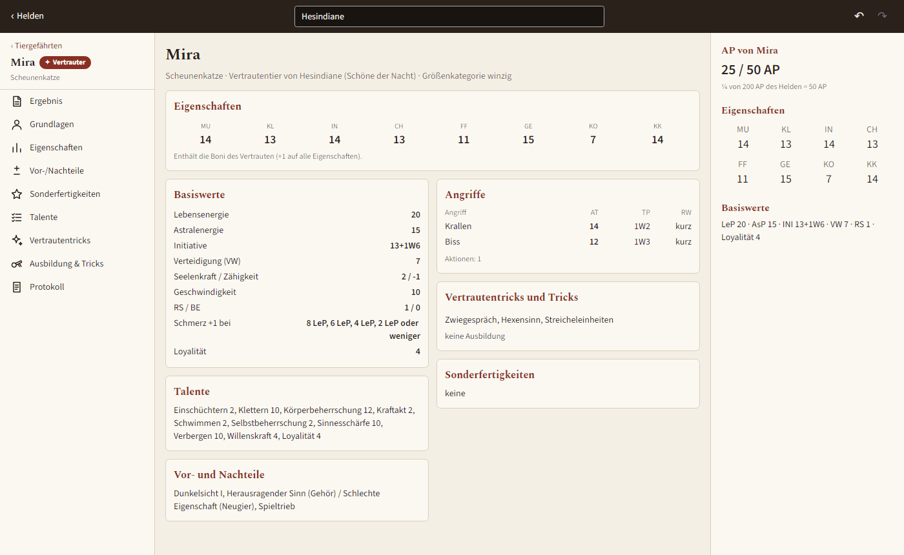 |
| **Charakterbogen in der App** | **Stil „Nachtlager“** |
| 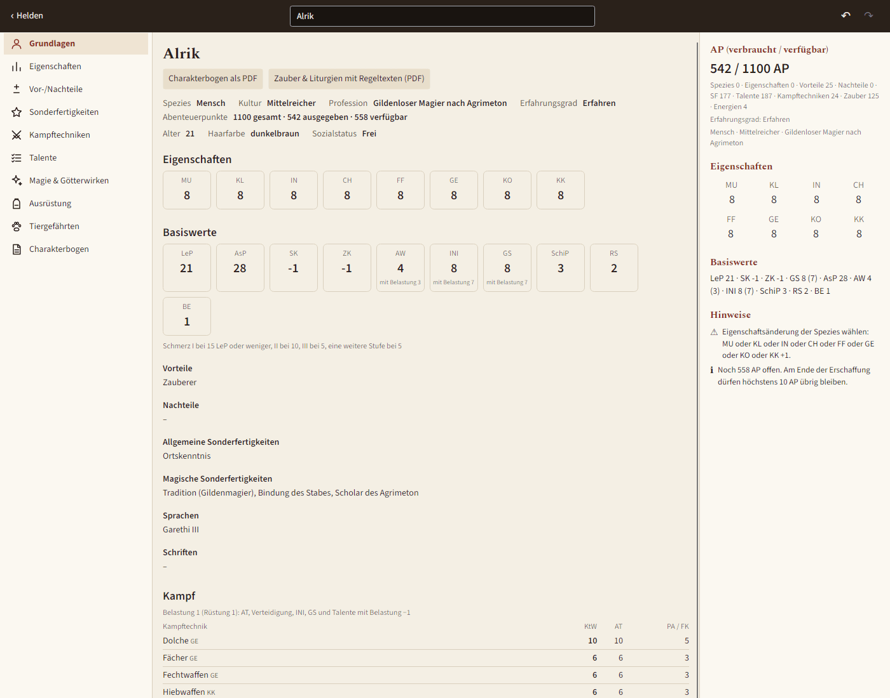 | 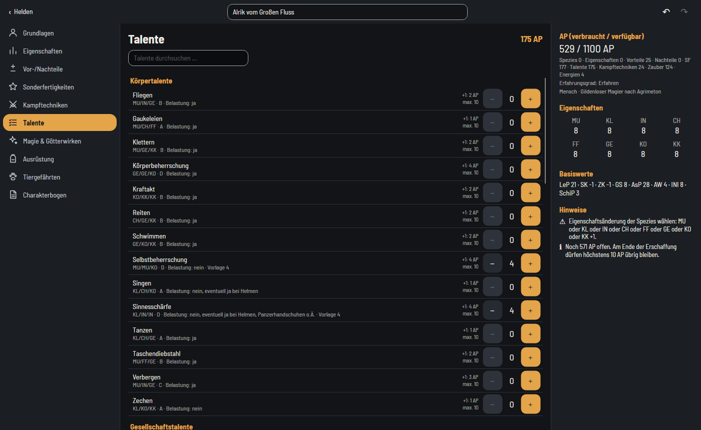 |

<table>
  <tr>
    <th>Am Handy</th>
    <th>Am Handy, „Nachtlager“</th>
    <th>PDF-Bogen</th>
  </tr>
  <tr>
    <td>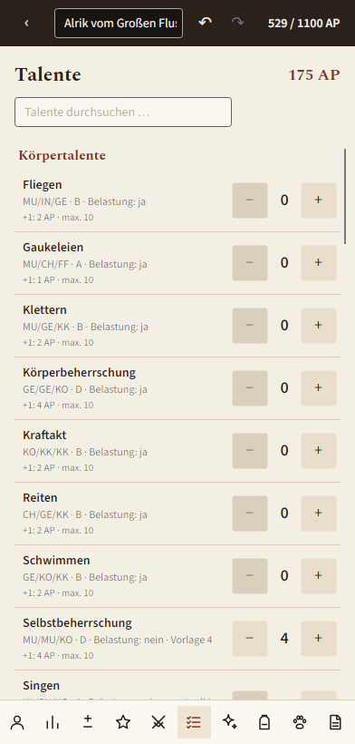</td>
    <td>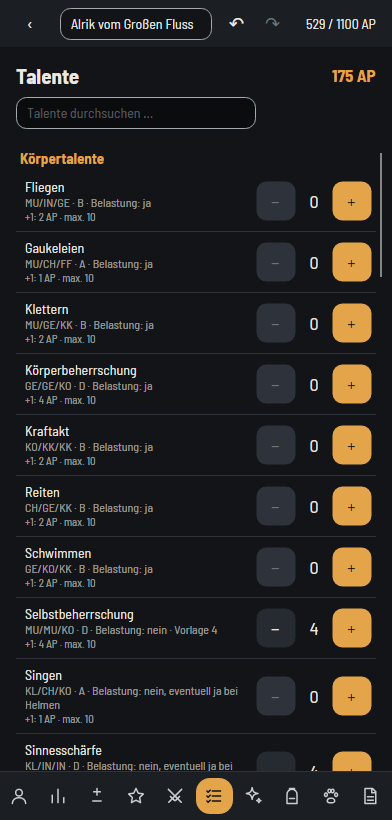</td>
    <td>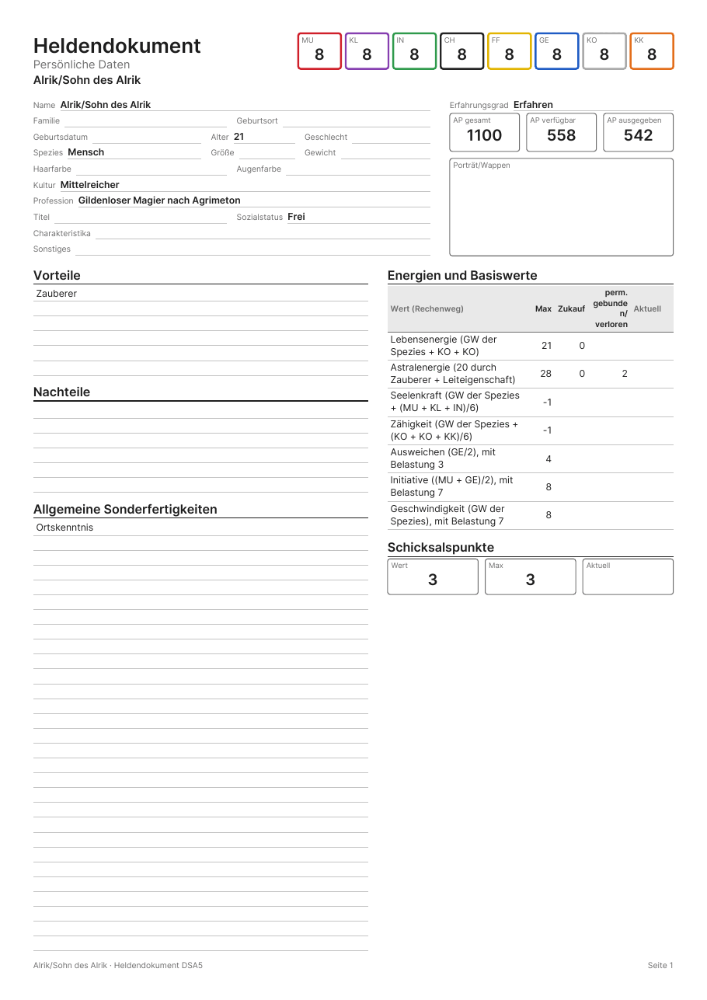</td>
  </tr>
</table>

## Installation

Die fertigen Dateien stehen unter [Releases](../../releases).

| System | Datei | Hinweis |
|---|---|---|
| Windows (x64) | `DieSchwarzeAhnentafel.exe` | Eine Datei mit eigener .NET-Laufzeit, keine Installation nötig. |
| Linux (x64) | `DieSchwarzeAhnentafel` | Ausführbar machen: `chmod +x DieSchwarzeAhnentafel` |
| Android (arm64, ab 6.0) | `DieSchwarzeAhnentafel.apk` | Installation aus unbekannten Quellen erlauben. |

## Inhalte

Alle Regelinhalte (Werte, Regeltexte, Voraussetzungen, AP-Kosten, Publikationen) stammen aus dem offiziellen
[Ulisses DSA Regel-Wiki](https://dsa.ulisses-regelwiki.de/). Texte aus Büchern oder PDFs sind nicht enthalten. Was
bereits erfasst ist, steht in [docs/CONTENT_STATUS.md](docs/CONTENT_STATUS.md). Wo das Wiki sich selbst widerspricht
(etwa beim AP-Wert eines Pakets), listet [docs/WIKI_ABWEICHUNGEN.md](docs/WIKI_ABWEICHUNGEN.md) die Stellen auf.

Erfasst sind unter anderem 10 Spezies, 43 Kulturen, 296 Professionen, alle Talente und Kampftechniken, über 250
Vor- und Nachteile, rund 1 900 Sonderfertigkeiten, Zauber, Rituale, Liturgien und Zeremonien mit ihren Erweiterungen,
Waffen, Rüstungen, Ausrüstung sowie 215 Tierarten für Tiergefährten.

*Das Schwarze Auge* und *Aventurien* sind Marken der Ulisses Spiele GmbH. Dieses Projekt ist ein inoffizielles
Fanprojekt und steht in keiner Verbindung zu Ulisses Spiele.

## Selbst bauen

Voraussetzung ist das .NET-10-SDK, für Android zusätzlich das Android-SDK und JDK 21.

```bash
dotnet run --project src/DSACharacterCreator.Desktop
dotnet test --solution DSACharacterCreator.slnx
```

Veröffentlichen (Ausgabe in `bin/publish/<profil>/`):

```bash
dotnet publish src/DSACharacterCreator.Desktop -p:PublishProfile=linux-x64
dotnet publish src/DSACharacterCreator.Desktop -p:PublishProfile=win-x64
dotnet publish src/DSACharacterCreator.Android -p:PublishProfile=android-apk
```

Aufbau und Planung: [docs/PLAN.md](docs/PLAN.md), offene Punkte: [docs/OFFENE_PUNKTE.md](docs/OFFENE_PUNKTE.md).

## Technik

C# und .NET 10, [Avalonia 12](https://avaloniaui.net/) für die Oberfläche auf allen Plattformen,
CommunityToolkit.Mvvm, SkiaSharp für das PDF, xUnit mit Avalonia.Headless für die Oberflächentests.
